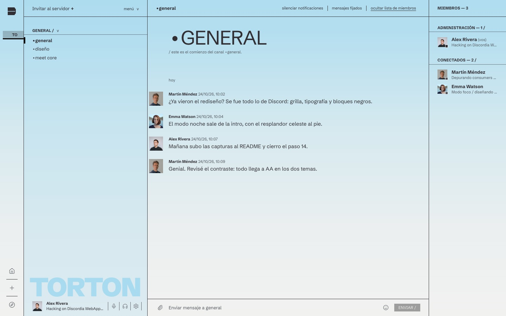
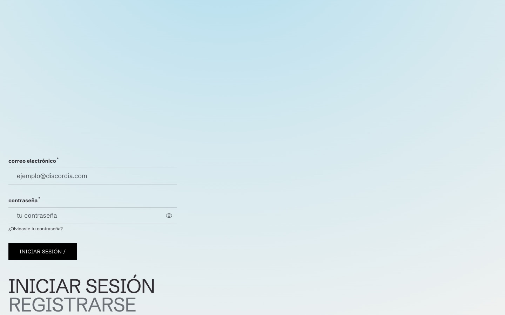
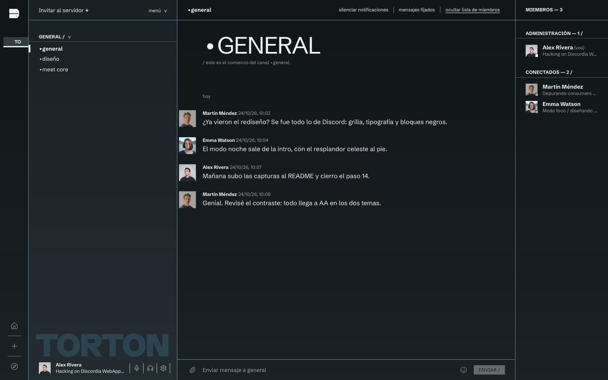
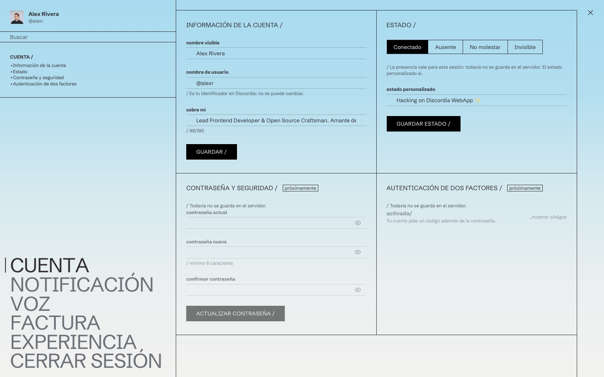
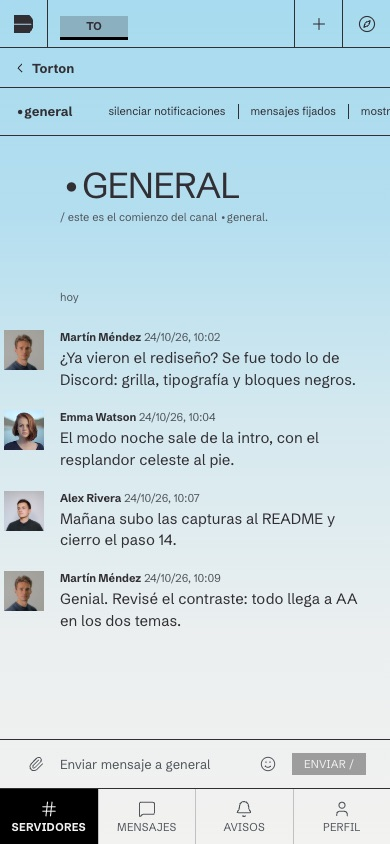

# Discordia-WebApp

Clientes de Discordia: la web (React + Vite) y la app mobile (Expo / React Native), en un monorepo con
npm workspaces.



```text
apps/
├── web/        cliente web (Cloudflare Pages en producción)
└── mobile/     app mobile (Expo, ver apps/mobile/README.md)
packages/
├── core/       lógica compartida: API, tipos, sesión y auth, hooks de datos, chat en tiempo real, voz
└── tokens/     tokens de diseño: tokens.css para la web y nativeTheme() para mobile
docs/           ADRs, planes (TODO-REDISENO.md), guía de pruebas y capturas
```

## Requisitos

- Node 22 (`.nvmrc`: Expo SDK 58 y React Native 0.88 lo piden). Con nvm: `nvm use`.
- Las dependencias se instalan **una sola vez, desde la raíz**: `npm install`. No correr `npm install`
  adentro de `apps/*`: el monorepo tiene un único `package-lock.json` y una sola copia de React para los dos
  clientes.
- El backend levantado desde el orquestador (`docker compose up -d` en su raíz).

## Web

```bash
cp apps/web/.env.example apps/web/.env   # URL de la API y Auth0
npm run dev                              # http://localhost:5173
npm test                                 # tests de todos los workspaces
npm run typecheck                        # TypeScript de web y mobile
npm run build                            # deja el build en dist/ (raíz)
```

`dist/` queda en la raíz porque ahí lo buscan Cloudflare Pages y el `Dockerfile`.

## Mobile

```bash
npm run mobile        # = expo start --go, desde la raíz
```

El resto (development build, voz, EAS) está en [`apps/mobile/README.md`](apps/mobile/README.md).

## Diseño

Lenguaje visual propio, editorial / suizo: grilla de líneas finas, Schibsted Grotesk, radio 0, bloques negros
invertidos y un degradé de cielo de fondo, con modo noche. Las decisiones y sus porqués están en
[`docs/ADR-02-Lenguaje-Visual.md`](docs/ADR-02-Lenguaje-Visual.md), y las reglas completas en
[`docs/TODO-REDISENO.md`](docs/TODO-REDISENO.md).

| Acceso | Inicio | Modo noche |
|---|---|---|
|  |  |  |

| Ajustes | Catálogo de componentes | Mobile web |
|---|---|---|
|  |  |  |

### Tokens

Los colores, los degradés, la tipografía, el espaciado y el movimiento están en `packages/tokens/src`, y salen
como `tokens.css` para la web y como `nativeTheme()` para mobile. Los componentes usan solo tokens. Después
de cambiar uno, regenerar el CSS y commitearlo junto con el cambio (si no, falla un test):

```bash
npm run build:css -w @discordia/tokens   # reescribe packages/tokens/tokens.css
```

`contrast.test.ts` verifica que cada par texto/fondo llegue a WCAG AA en los dos temas.

### Componentes y tema

- Catálogo de la web en `apps/web/src/ui` (los mismos nombres y props que `apps/mobile/src/ui`). Se ve en
  `http://localhost:5173/?catalogo`, solo en desarrollo.
- Tema: claro, oscuro o el del sistema (por defecto). Se elige en *Ajustes → Experiencia* o con
  `?tema=claro|oscuro|sistema`, y se recuerda en el navegador (`apps/web/src/ui/theme.ts`).
- Sin backend: `VITE_USE_MOCK=true npm run dev -w @discordia/web` entra con cualquier email y contraseña.
  Detalles en [`docs/GUIA-PRUEBAS-REDISENO.md`](docs/GUIA-PRUEBAS-REDISENO.md).

### Accesibilidad y rendimiento

- Foco visible en todo lo interactivo, modales con el foco atrapado (Escape cierra), pestañas con flechas y
  `prefers-reduced-motion` respetado (todo queda en fundidos de 150 ms y se omite la intro).
- `npm test` corre axe-core sobre el catálogo completo y sobre las pantallas principales (inicio, chat,
  ajustes, crear servidor y mobile web). El contraste lo cubren los tokens y Lighthouse.
- Lighthouse sobre el build, en la pantalla de acceso (24/10/2026): rendimiento 99 en escritorio y 91 en
  mobile, accesibilidad 100. Buenas prácticas da 77 por la cookie de terceros del login silencioso de
  Auth0.
- El bundle está partido: react, motion, auth0 y react-query van en chunks propios que se reusan entre
  deploys. Los ajustes y el perfil propio se cargan aparte (y se precargan en segundo plano), y livekit
  recién al entrar a un canal de voz.

## Agregar una dependencia

```bash
npm install <paquete> -w @discordia/web      # o @discordia/mobile, @discordia/core, @discordia/tokens
```

React, React Native y TypeScript tienen que quedar en **una sola versión** para todo el repo (Expo no
soporta copias duplicadas de React en el monorepo): verificarlo con `npm ls react`.

## Docker

`Dockerfile` (producción, nginx) y `Dockerfile.dev` (Vite con recarga) se construyen con la raíz del repo
como contexto e instalan solo las dependencias de la web. Los usa el `docker-compose.yml` del orquestador.

## CI

`.github/workflows/ci.yml` corre en cada push y pull request a `main` y `develop`, con Node 22 (`.nvmrc`):
typecheck de los cuatro workspaces, tests, build de la web (lo mismo que compila Cloudflare Pages), bundle de
mobile con Metro y build de la imagen de Docker (no se publica). Falta ESLint: el script `lint` de la web
todavía no tiene configuración.
