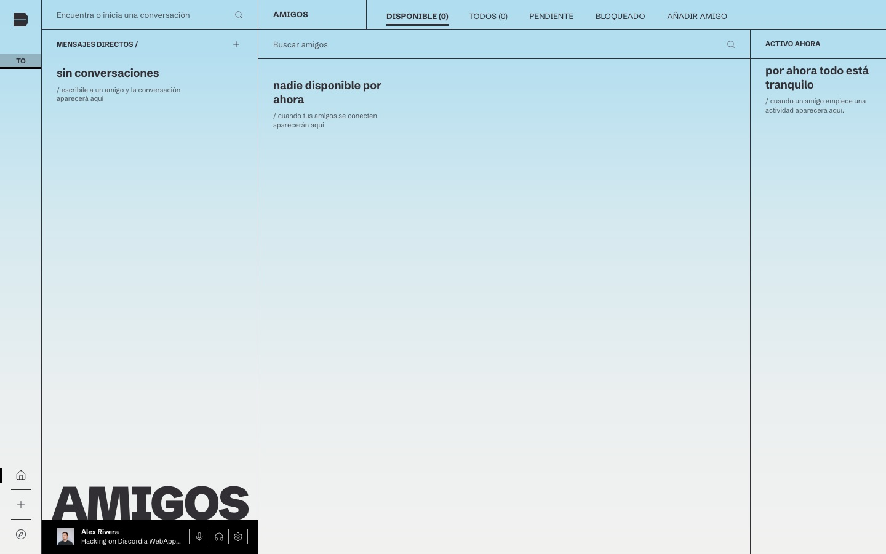
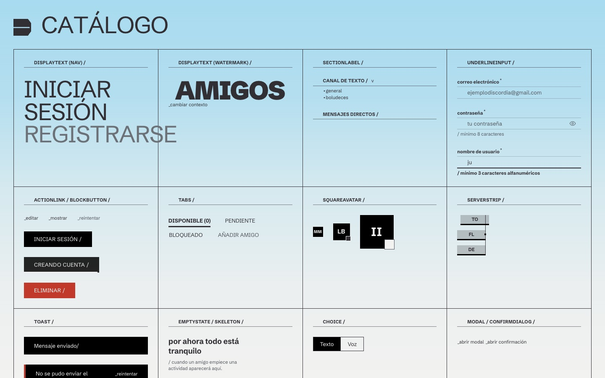

# Discordia-WebApp

Clientes de Discordia: la web (React + Vite), el backoffice del staff (React + Vite) y la app mobile
(Expo / React Native), en un monorepo con npm workspaces.


```text
apps/
├── web/        cliente web (Cloudflare Pages en producción)
├── backoffice/ backoffice de la plataforma, solo staff (backoffice.discordia.lol, ver apps/backoffice/README.md)
└── mobile/     app mobile (Expo, ver apps/mobile/README.md)
packages/
├── core/       lógica compartida: API, tipos, sesión y auth, hooks de datos, chat en tiempo real, voz
└── tokens/     tokens de diseño: tokens.css para la web y nativeTheme() para mobile
docs/           ADRs, planes (TODO-REDISENO.md), guía de pruebas y capturas
```

## Requisitos

- Node 22 (`.nvmrc`: Expo SDK 58 y React Native 0.88 lo piden). Con nvm: `nvm use`.
- Las dependencias se instalan **una sola vez, desde la raíz**: `npm install`. No correr `npm install`
  adentro de `apps/*`: el monorepo tiene un único `package-lock.json` y una sola copia de React para los dos
  clientes.
- Un backend, según lo que se quiera probar (ver la tabla de abajo).

## Contra qué backend

| Opción | Cómo | Para qué |
|---|---|---|
| Sin backend | `VITE_USE_MOCK=true npm run dev` | Interfaz y componentes. Entra con cualquier email y contraseña, con datos de ejemplo |
| Backend local completo | En `discordia-orchestrator`: `docker compose -f deploy/docker-compose.yml up -d --build` (ver su `deploy/README.md`). Kong queda en `localhost:8000`, que es el default de `.env.example` | Desarrollo de punta a punta |
| Producción | `VITE_API_URL=https://api.discordia.lol` en `apps/web/.env` | Probar la interfaz contra datos reales. **Cuidado:** todo lo que se haga queda guardado |

El login es siempre el de Auth0 (tenant de desarrollo del equipo), salvo en modo mock. Kong acepta pedidos
desde `http://localhost:5173` (CORS).

## Web

```bash
cp apps/web/.env.example apps/web/.env   # URL de la API (Kong) y modo mock
npm run dev                              # http://localhost:5173
npm test                                 # tests de todos los workspaces
npm run typecheck                        # TypeScript de web y mobile
npm run lint                             # ESLint de todo el monorepo
npm run build                            # deja el build en dist/ (raíz)
```

`dist/` queda en la raíz porque ahí lo buscan Cloudflare Pages y el `Dockerfile`.

Variables de `apps/web/.env` (Vite las toma al arrancar `npm run dev`):

| Variable | Default | Descripción |
|---|---|---|
| `VITE_API_URL` | `http://localhost:8000` | API Gateway (Kong). La URL de los WebSockets de chat y de voz sale de esta (`http` → `ws`), así también pasan por Kong |
| `VITE_AUTH0_DOMAIN` / `VITE_AUTH0_CLIENT_ID` / `VITE_AUTH0_AUDIENCE` | tenant de desarrollo | Auth0. Los defaults están en `apps/web/src/platform/auth/auth0.ts`; el client ID de una SPA es público |
| `VITE_USE_MOCK` | `false` | `true`: sin backend, con datos de ejemplo. El build de producción lo ignora |
| `VITE_BACKOFFICE_URL` | `http://localhost:5174` | Backoffice, para el link del menú de usuario (solo lo ve el staff) |

En producción, Cloudflare Pages compila con `VITE_API_URL=https://api.discordia.lol` y los valores de Auth0
(Terraform del orquestador, `infra/terraform/pages.tf`).

### Compartir pantalla con audio

El audio de la pantalla compartida lo captura el navegador (`getDisplayMedia`), no la app. `useVoiceRoom` lo
pide siempre (`createLocalScreenTracks({ audio: true })`), pero si el navegador no devuelve un track de audio,
la pantalla se comparte igual, solo con video y sin error.

| Navegador | Pestaña | Ventana | Pantalla completa |
|---|---|---|---|
| Chrome / Edge en Windows o ChromeOS | Sí | No | Sí (audio del sistema) |
| Chrome / Edge en macOS o Linux | Sí | No | No |
| Firefox | No | No | No |
| Safari | No | No | No |
| Mobile (React Native) | — | — | No: solo video |

- En Chrome y Edge, el audio de una pestaña se comparte solo si se marca **"Compartir también el audio de la
  pestaña"** en el selector. Sin ese checkbox no hay audio, aunque la pestaña esté sonando.
- Quien comparte no escucha su propio audio. Para probarlo hacen falta dos clientes: en el otro tiene que
  sonar.
- Para revisar si el audio llega: en el receptor, `chrome://webrtc-internals` tiene que mostrar un segundo
  `inbound-rtp` de audio con `bytesReceived` subiendo.

## Backoffice

```bash
npm run dev:backoffice                          # http://localhost:5174
VITE_USE_MOCK=true npm run dev:backoffice       # sin Auth0 ni backend, entra como staff
npm run build:backoffice                        # deja el build en apps/backoffice/dist
```

Login, rol staff, configuración de Auth0 y estado de cada sección: [`apps/backoffice/README.md`](apps/backoffice/README.md).

## Mobile

```bash
npm run mobile        # = expo start --go, desde la raíz
npm run mobile -- -c  # lo mismo, limpiando el cache de Metro
```

**No correr `npx expo start` en la raíz.** La raíz no es un proyecto de Expo: Expo la toma como tal, cae en
`node_modules/expo/AppEntry.js` y falla con `Unable to resolve module ../../App`. De paso deja un
`tsconfig.json` y un `.expo/` sueltos en la raíz (borrarlos). `npm run mobile` corre Expo adentro de
`apps/mobile`. Si ya pasó, arrancar de nuevo con `npm run mobile -- -c`.

Sin configurar nada, la app usa la IP de la máquina que corre Metro, puerto 8000 (el Kong del backend
local). Para apuntar a producción, `EXPO_PUBLIC_API_URL=https://api.discordia.lol` en `apps/mobile/.env`
(ver `apps/mobile/.env.example`). El resto (development build, voz, EAS) está en
[`apps/mobile/README.md`](apps/mobile/README.md).

## Diseño

Lenguaje visual propio, editorial / suizo: grilla de líneas finas, Schibsted Grotesk, radio 0, bloques negros
invertidos y un degradé de cielo de fondo, con modo noche. Las decisiones y sus porqués están en
[`docs/ADR-02-Lenguaje-Visual.md`](docs/ADR-02-Lenguaje-Visual.md), y las reglas completas en
[`docs/TODO-REDISENO.md`](docs/TODO-REDISENO.md).

| Acceso | Inicio | Modo noche |
|---|---|---|
|  |  |  |

| Ajustes | Catálogo de componentes | Mobile web |
|---|---|---|
|  |  |  |

### Tokens

Los colores, los degradés, la tipografía, el espaciado y el movimiento están en `packages/tokens/src`, y salen
como `tokens.css` para la web y como `nativeTheme()` para mobile. Los componentes usan solo tokens. Después
de cambiar uno, regenerar el CSS y commitearlo junto con el cambio (si no, falla un test):

```bash
npm run build:css -w @discordia/tokens   # reescribe packages/tokens/tokens.css
```

`contrast.test.ts` verifica que cada par texto/fondo llegue a WCAG AA en los dos temas.

### Componentes y tema

- Catálogo de la web en `apps/web/src/ui` (los mismos nombres y props que `apps/mobile/src/ui`). Se ve en
  `http://localhost:5173/?catalogo`, solo en desarrollo.
- Tema: claro, oscuro o el del sistema (por defecto). Se elige en *Ajustes → Experiencia* o con
  `?tema=claro|oscuro|sistema`, y se recuerda en el navegador (`apps/web/src/ui/theme.ts`).
- Sin backend: `VITE_USE_MOCK=true npm run dev -w @discordia/web` entra con cualquier email y contraseña.
  Detalles en [`docs/GUIA-PRUEBAS-REDISENO.md`](docs/GUIA-PRUEBAS-REDISENO.md).

### Accesibilidad y rendimiento

- Foco visible en todo lo interactivo, modales con el foco atrapado (Escape cierra), pestañas con flechas y
  `prefers-reduced-motion` respetado (todo queda en fundidos de 150 ms y se omite la intro).
- `npm test` corre axe-core sobre el catálogo completo y sobre las pantallas principales (inicio, chat,
  ajustes, crear servidor y mobile web). El contraste lo cubren los tokens y Lighthouse.
- Lighthouse sobre el build, en la pantalla de acceso (24/10/2026): rendimiento 99 en escritorio y 91 en
  mobile, accesibilidad 100. Buenas prácticas da 77 por la cookie de terceros del login silencioso de
  Auth0.
- El bundle está partido: react, motion, auth0 y react-query van en chunks propios que se reusan entre
  deploys. Los ajustes y el perfil propio se cargan aparte (y se precargan en segundo plano), y livekit
  recién al entrar a un canal de voz.

## Agregar una dependencia

```bash
npm install <paquete> -w @discordia/web      # o @discordia/mobile, @discordia/core, @discordia/tokens
```

React, React Native y TypeScript tienen que quedar en **una sola versión** para todo el repo (Expo no
soporta copias duplicadas de React en el monorepo): verificarlo con `npm ls react`.

## Docker

`Dockerfile` (producción, nginx) y `Dockerfile.dev` (Vite con recarga) se construyen con la raíz del repo
como contexto e instalan solo las dependencias de la web. Los usa el `docker-compose.yml` del orquestador.

## CI

`.github/workflows/ci.yml` corre en cada push y pull request a `main` y `develop`, con Node 22 (`.nvmrc`):
typecheck y lint de los cinco workspaces, `npm audit` (informativo, no bloquea), tests, build de la web y del
backoffice (lo mismo que compila Cloudflare Pages), bundle de mobile con Metro y build de la imagen de Docker (no se publica).

No hay deploy desde el CI: Cloudflare Pages publica la web y el backoffice solos en cada push a `main`. La app mobile se
compila con EAS (ver `apps/mobile/README.md`).

El lint usa una sola configuración para todo el monorepo (`eslint.config.mjs`) y falla solo con errores. Las
reglas del React Compiler (`react-hooks/refs`, `set-state-in-effect`, `purity` y
`preserve-manual-memoization`) están como avisos hasta revisar esos patrones, sobre todo en `ChatView` y
`ServerSettingsScreen`.
