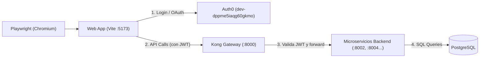

# Pruebas End-to-End (E2E) en Discordia

Este documento explica la arquitectura del sistema de pruebas E2E de Discordia, el flujo de autenticación contra backend real y el manual operativo con los comandos necesarios.

---

## 1. ¿Cómo funciona el sistema E2E?

Las pruebas E2E validan la experiencia real del usuario en el navegador interactuando con toda la plataforma conectada.

### Arquitectura del flujo



1. **Navegador automatizado**: Playwright levanta Chromium y accede a `http://localhost:5173`.
2. **Autenticación real**: El formulario envía las credenciales de prueba a Auth0 (`password-realm`), obteniendo un token JWT válido y firmado.
3. **Paso por Gateway**: Las peticiones de la app van a `http://localhost:8000`. Kong ejecuta el plugin `auth0_validator.lua`, valida el JWT, extrae `X-User-Id` y reenvía la petición al servicio correspondiente.
4. **Persistencia real**: El microservicio (`Server-Roles-Core-Service`) ejecuta la lógica de negocio y persiste los cambios en la base de datos PostgreSQL local (`server_roles_db`).
5. **Verificación visual y funcional**: Playwright verifica que la respuesta se refleje en el DOM (por ejemplo, el nuevo servidor renderizado en la barra lateral).

---

## 2. Tipos de Tests E2E disponibles

Los tests residen en `Discordia-WebApp/apps/web/e2e/`:

| Archivo | Área | Descripción |
|---|---|---|
| `fullstack.spec.ts` | **Full-Stack Backend** | Autentica con Auth0, le pega a Kong Gateway y crea servidores en PostgreSQL. |
| `channels.spec.ts` | **Canales y Categorías** | Crea un canal de texto y una categoría en el servidor contra la base de datos real. |
| `chat.spec.ts` | **Mensajería y Chat** | Envía mensajes en tiempo real en el canal de texto y valida su renderizado. |
| `invites.spec.ts` | **Invitaciones** | Genera enlaces de invitación con código único para unirse al servidor. |
| `user-settings.spec.ts` | **Ajustes y Logout** | Recorre secciones de ajustes de usuario y prueba el cierre de sesión seguro. |
| `auth.spec.ts` | **UI de Acceso** | Valida campos, alternancia login/registro y alertas de error. |
| `mi-nuevo-test.spec.ts` | **Flujo Grabado** | Prueba generada mediante `playwright codegen` tocando la pantalla. |

---

## 3. Aislamiento e Idempotencia (Limpieza Automática)

Cada prueba es **hermética e independiente**: no depende de corridas previas ni deja datos residuales.
- **`beforeEach`**: Antes de iniciar el test, se eliminan todos los servidores creados por el usuario de prueba (`DELETE FROM servers WHERE owner_id = 'auth0|6ae25c494d4ba47b0ff49739'`). El test siempre arranca con **0 servidores**.
- **`afterAll`**: Al finalizar la suite, se vuelven a purgar los registros de prueba en PostgreSQL, dejando la base limpia para el desarrollo habitual o la siguiente ejecución.

---

## 4. Credenciales de Prueba

Para no depender de mails personales ni exponer cuentas privadas, se utiliza un usuario de servicio verificado:

- **Email**: `discordia.chat.service@gmail.com`
- **Contraseña**: `Password123!`
- **Auth0 ID**: `auth0|6ae25c494d4ba47b0ff49739`
- **Estado**: Email verificado en Auth0 y perfil sincronizado en `auth_db`.

---

## 5. Manual Operativo (Comandos)

> **Importante**: La mayoría de los comandos del frontend se ejecutan desde el directorio `Discordia-WebApp`.

### Preparación del entorno

```bash
# 1. Asegurarse de tener el backend y PostgreSQL corriendo (desde discordia-orchestrator)
docker compose up -d

# 2. Entrar al proyecto Web
cd Discordia-WebApp

# 3. Instalar dependencias si es la primera vez
npm install

# 4. Instalar el navegador de Playwright (solo se hace una vez)
npx playwright install chromium
```

---

### Ejecución de Pruebas

#### A. Ejecutar todos los tests E2E en consola
Levanta el servidor automáticamente en `:5173`, corre toda la suite y muestra el reporte:
```bash
npm run test:e2e
```

#### B. Ejecutar con Interfaz Gráfica (UI interactiva)
Permite ver paso a paso lo que hace el test, pausar, inspeccionar el DOM y la red:
```bash
npm run test:e2e:ui
```

#### C. Ejecutar solo el test Full-Stack contra el Backend Real
```bash
npx --prefix apps/web playwright test e2e/fullstack.spec.ts
```

#### D. Grabar un nuevo test tocando la pantalla (Codegen)
Abre un navegador Chrome y una ventana inspectora; todo clic, texto tipeado o acción se convertirá automáticamente en código Playwright:
```bash
# 1. En una terminal, tener el frontend corriendo:
npm run dev

# 2. En otra terminal, iniciar la grabación apuntando al archivo que quieras crear:
npm run test:e2e:codegen
# O especificando el archivo destino:
npx playwright codegen -o apps/web/e2e/mi-nuevo-test.spec.ts http://localhost:5173
```

---

### Verificación y Calidad de Código

```bash
# Correr tests unitarios y de componentes (Vitest)
npm test

# Chequeo estricto de tipos TypeScript
npm run typecheck

# Verificar en PostgreSQL los servidores creados por los tests
docker exec discordia-postgres psql -U postgres -d server_roles_db -c \
  "SELECT id, name, owner_id, created_at FROM servers ORDER BY created_at DESC LIMIT 5;"
```

---

## 6. Integración Continua (GitHub Actions)

El workflow en `.github/workflows/ci.yml` ejecuta automáticamente en cada push y PR:
1. `npm test` (pruebas unitarias con Vitest).
2. `npx playwright install --with-deps chromium`.
3. `npm run test:e2e` (pruebas E2E completas).
4. Sube el reporte HTML de Playwright como artefacto disponible para descarga en caso de fallo.

