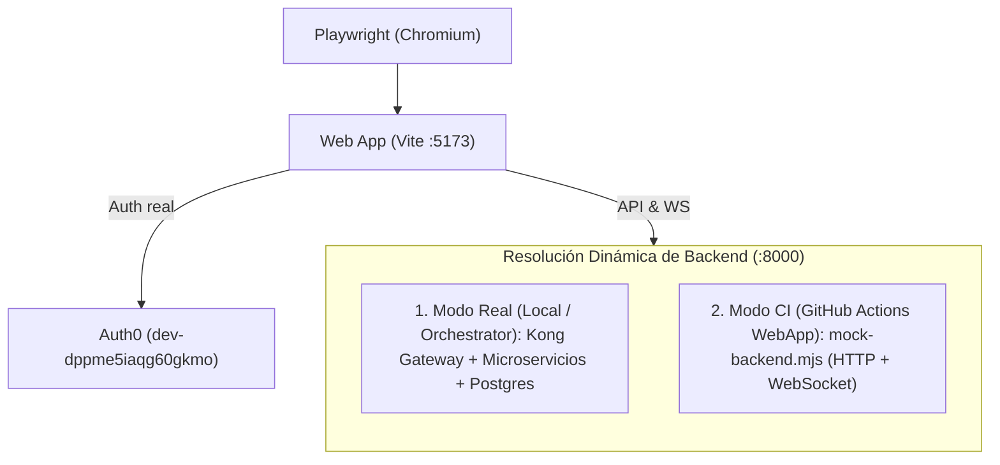

# Pruebas End-to-End (E2E) en Discordia

Este documento explica la arquitectura del sistema de pruebas E2E de Discordia, el flujo de autenticación contra backend real y el manual operativo con los comandos necesarios.

---

## 1. ¿Cómo funciona el sistema E2E? (Arquitectura Dual)

Las pruebas E2E validan la experiencia real del usuario en el navegador interactuando con toda la plataforma. Para permitir la máxima flexibilidad, el sistema cuenta con un **motor de ejecución dual**:

### Diagrama de Arquitectura



### Modos de Ejecución:

1. **Modo Real / Full-Stack (Local o en Orchestrator con Docker):**
   - Playwright detecta que el API Gateway está corriendo en `http://localhost:8000/livez` (`reuseExistingServer: true`).
   - Las peticiones van a **Kong Gateway**, se validan tokens reales, se comunican los microservicios (`Server-Roles`, `Chat-Engine`, etc.) y se persiste en **PostgreSQL**.
2. **Modo Aislado / CI (GitHub Actions en `Discordia-WebApp`):**
   - En el entorno de CI del frontend no se dispone de Docker ni de los 7 microservicios.
   - Playwright detecta el puerto 8000 libre y arranca automáticamente `node ./e2e/mock-backend.mjs`.
   - Este mock atiende las rutas necesarias (`/api/v1/users/me`, `/api/v1/servers`, `/channels`, `/categories`, `/invites` y WebSocket de chat en tiempo real), permitiendo que **los 9 tests de interfaz corran y aprueben en ~1 minuto con 0 dependencias externas**.

---

## 2. Tipos de Tests E2E disponibles

Los tests residen en `Discordia-WebApp/apps/web/e2e/`:

| Archivo | Área | Descripción |
|---|---|---|
| `fullstack.spec.ts` | **Full-Stack Backend** | Autentica con Auth0, le pega a Kong Gateway y crea servidores en PostgreSQL. |
| `channels.spec.ts` | **Canales y Categorías** | Crea un canal de texto y una categoría en el servidor contra la base de datos real. |
| `chat.spec.ts` | **Mensajería y Chat** | Envía mensajes en tiempo real en el canal de texto y valida su renderizado. |
| `invites.spec.ts` | **Invitaciones** | Genera enlaces de invitación con código único para unirse al servidor. |
| `user-settings.spec.ts` | **Ajustes y Logout** | Recorre secciones de ajustes de usuario y prueba el cierre de sesión seguro. |
| `auth.spec.ts` | **UI de Acceso** | Valida campos, alternancia login/registro y alertas de error. |
| `mi-nuevo-test.spec.ts` | **Flujo Grabado** | Prueba generada mediante `playwright codegen` tocando la pantalla. |

---

## 3. Aislamiento e Idempotencia (Limpieza Automática)

Cada prueba es **hermética e independiente**: no depende de corridas previas ni deja datos residuales.
- **`beforeEach`**: Antes de iniciar cada test, se eliminan todos los servidores creados por el usuario de prueba mediante SQL en PostgreSQL (`DELETE FROM servers WHERE owner_id = 'auth0|6ae25c494d4ba47b0ff49739'`) y mediante reset HTTP al mock en caso de correr en CI (`DELETE /api/v1/servers/test-reset`). El test siempre arranca con **0 servidores**.
- **`afterAll`**: Al finalizar la suite, se vuelven a purgar los registros de prueba, dejando tanto la base de datos como el mock completamente limpios.

---

## 4. Credenciales de Prueba

Para no depender de mails personales ni exponer cuentas privadas, se utiliza un usuario de servicio verificado:

- **Email**: `discordia.chat.service@gmail.com`
- **Contraseña**: `Password123!`
- **Auth0 ID**: `auth0|6ae25c494d4ba47b0ff49739`
- **Estado**: Email verificado en Auth0 y perfil sincronizado en `auth_db`.

---

## 5. Manual Operativo (Comandos)

> **Importante**: La mayoría de los comandos del frontend se ejecutan desde el directorio `Discordia-WebApp`.

### Preparación del entorno

```bash
# 1. Asegurarse de tener el backend y PostgreSQL corriendo (desde discordia-orchestrator)
docker compose up -d

# 2. Entrar al proyecto Web
cd Discordia-WebApp

# 3. Instalar dependencias si es la primera vez
npm install

# 4. Instalar el navegador de Playwright (solo se hace una vez)
npx playwright install chromium
```

---

### Ejecución de Pruebas

#### A. Ejecutar todos los tests E2E en consola
Levanta el servidor automáticamente en `:5173`, corre toda la suite y muestra el reporte:
```bash
npm run test:e2e
```

#### B. Ejecutar con Interfaz Gráfica (UI interactiva)
Permite ver paso a paso lo que hace el test, pausar, inspeccionar el DOM y la red:
```bash
npm run test:e2e:ui
```

#### C. Ejecutar solo el test Full-Stack contra el Backend Real
```bash
npx --prefix apps/web playwright test e2e/fullstack.spec.ts
```

#### D. Grabar un nuevo test tocando la pantalla (Codegen)
Abre un navegador Chrome y una ventana inspectora; todo clic, texto tipeado o acción se convertirá automáticamente en código Playwright:
```bash
# 1. En una terminal, tener el frontend corriendo:
npm run dev

# 2. En otra terminal, iniciar la grabación apuntando al archivo que quieras crear:
npm run test:e2e:codegen
# O especificando el archivo destino:
npx playwright codegen -o apps/web/e2e/mi-nuevo-test.spec.ts http://localhost:5173
```

---

### Verificación y Calidad de Código

```bash
# Correr tests unitarios y de componentes (Vitest)
npm test

# Chequeo estricto de tipos TypeScript
npm run typecheck

# Verificar en PostgreSQL los servidores creados por los tests
docker exec discordia-postgres psql -U postgres -d server_roles_db -c \
  "SELECT id, name, owner_id, created_at FROM servers ORDER BY created_at DESC LIMIT 5;"
```

---

## 6. Integración Continua (GitHub Actions) y Estrategia Multi-Repo

La plataforma está desacoplada en repositorios independientes (`Discordia-WebApp` y `discordia-orchestrator`), por lo que la estrategia de integración continua se adapta a cada uno:

### A. En el repositorio `Discordia-WebApp`
El workflow en `.github/workflows/ci.yml` ejecuta automáticamente en cada push y PR:
1. `npm run typecheck` y `npm run lint`.
2. `npm test` (pruebas unitarias y de componentes con Vitest).
3. `npx playwright install --with-deps chromium`.
4. `npm run test:e2e` (pruebas E2E completas con Playwright).
   - Playwright detecta que no hay backend activo en el runner y levanta el `mock-backend.mjs`.
   - Se ejecutan los 9 tests E2E validando flujos de login, navegación, WebSockets, modales y validaciones.
   - Duración: ~1 minuto. No requiere contenedores Docker ni acceso a repositorios privados del backend.
5. Sube el reporte HTML de Playwright como artefacto descargable si hay fallos.

### B. Relación con `discordia-orchestrator`
El repositorio `discordia-orchestrator` contiene a `Discordia-WebApp` y al resto de los microservicios como **submódulos de Git**:
- **Desarrollo local**: Al correr `docker compose up -d` en el orchestrator, el Gateway y PostgreSQL están activos. Cualquier ejecución de `npm run test:e2e` en `Discordia-WebApp` correrá directamente contra los microservicios reales.
- **Actualización de versiones**: Cuando los cambios de `Discordia-WebApp` se mergean, en el orchestrator simplemente se actualiza el puntero del submódulo:
  ```bash
  git add Discordia-WebApp
  git commit -m "chore: actualizar submódulo Discordia-WebApp"
  ```
- **CI Full-Stack (Opcional en Orchestrator)**: Si se desea correr pruebas contra toda la infraestructura Dockerizada en GitHub Actions del orchestrator, se puede crear un workflow que haga `docker compose up -d --build` y luego ejecute `npm run test:e2e` dentro del submódulo de la WebApp.

